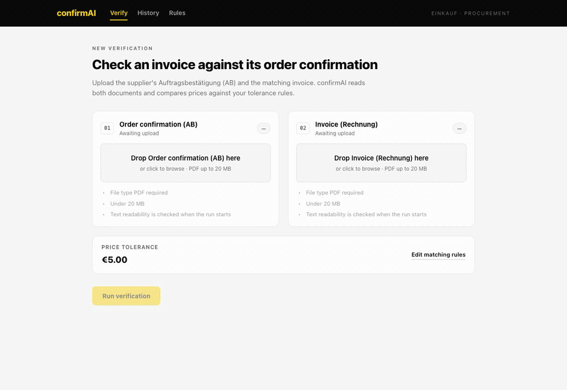
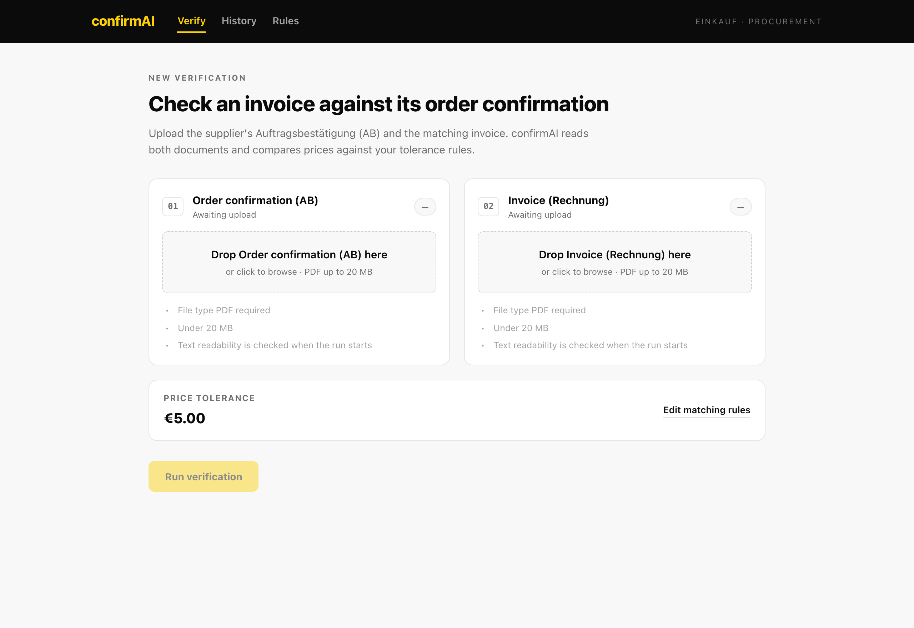
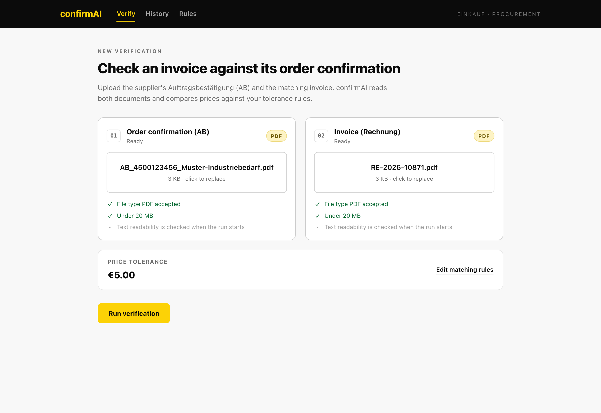
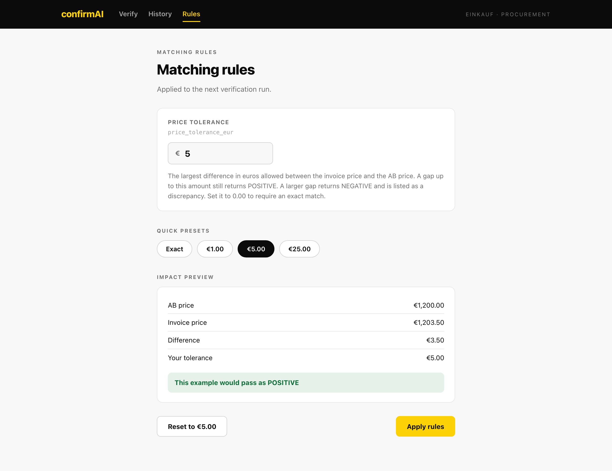
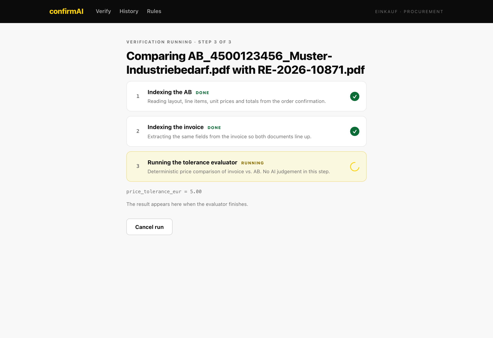
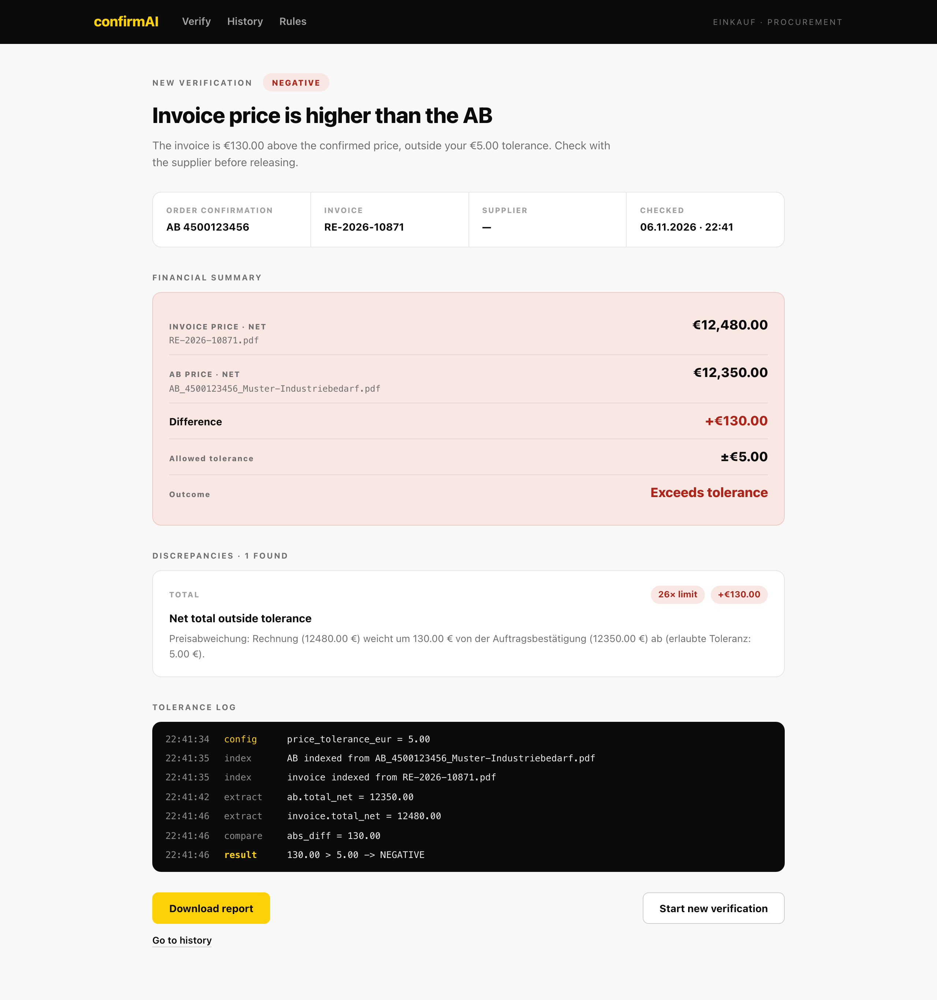

# confirmAI — Invoice ↔ Order-Confirmation Matcher

> An AI-assisted procurement tool that verifies a supplier's **invoice** against the
> original **order confirmation (Auftragsbestätigung, "AB")** and flags price
> deviations outside a configurable tolerance — with a full audit trail.

**Stack:** Python · FastAPI · LangChain · Ollama (Mistral + Nomic embeddings) · ChromaDB · Pydantic · pytest · React 18 · TypeScript · Vite

[](https://github.com/esosaphilip/confirmAI/actions/workflows/ci.yml)

---

## Demo

A full run — attach the AB and the invoice, run the check, and read the result:



<sub>▶ GIF runs at 2× speed. [Download the full-quality MP4](./.screenshots/demo.mp4)</sub>

---

## The problem

In B2B procurement, a buyer agrees a price in an **order confirmation** and later
receives an **invoice** from the same supplier. Invoices frequently drift from the
agreed price — a unit price changes, a total creeps up, or a discount is dropped.
Catching these deviations today is a manual, error-prone, line-by-line PDF reading
exercise that doesn't scale.

**confirmAI automates the check:** upload the two PDFs, and it extracts the relevant
totals, compares them against your tolerance rule, and returns a **POSITIVE / NEGATIVE**
verdict with the supporting evidence.

---

## Why it's interesting (design decisions)

This project deliberately **does not hand the decision to an LLM.** Instead it separates
fuzzy extraction from hard decisions:

| Concern | Owner | Why |
|---|---|---|
| Reading numbers out of messy PDFs | **LLM** (Mistral via Ollama) | Documents vary in layout, language and formatting; an LLM handles that variance. |
| Deciding pass/fail | **Deterministic Python** | Financial decisions must be reproducible and auditable — no hallucinated thresholds. |

This "**AI extracts, code decides**" split is the core architectural idea:

- The LLM is only ever asked for a **single number** (the document net total), never a judgement.
- Retrieval is scoped with **separate vector stores per document type** so the model never
  confuses the AB total with the invoice total.
- The model answers in **JSON mode** and its output is validated against a **Pydantic schema**
  (`ExtractedTotal`). If the JSON is broken, a regex fallback (`parse_amount`) reads the
  amount and handles German `1.234,56` and English `1,234.56` formats. Each extracted value
  is also checked against the source text and logged if it doesn't appear there verbatim.
- **Fail-safe by design:** if a total can't be extracted, the result is never `POSITIVE`.
  The run returns `NEGATIVE` with `needs_review: true` and a "manual review" discrepancy.
- The final comparison lives in its own module ([tolerance.py](tolerance.py)): `Decimal`
  arithmetic at cent precision (no float rounding surprises at the boundary), an inclusive
  limit, and no AI imports. It is covered by unit tests and visible in the **tolerance log**
  the UI shows the user.

Every run produces a timestamped log, so a result can be reconstructed after the fact.

---

## How it works

```
                    ┌──────────────────────────────────────────────┐
   AB.pdf  ─────────▶│  1. Index the AB      PyPDFLoader → split →   │
   Invoice.pdf ─────▶│                       Chroma (own store)      │
                    └──────────────────────────────────────────────┘
                                      │
                                      ▼
                    ┌──────────────────────────────────────────────┐
                    │  2. Extract the net total                    │
                    │     similarity search (totals-focused query) │
                    │     → Mistral → parse to float               │
                    └──────────────────────────────────────────────┘
                                      │
                                      ▼
                    ┌──────────────────────────────────────────────┐
                    │  3. Evaluate (deterministic, no AI)          │
                    │     |invoice − ab| > tolerance ? NEGATIVE    │
                    │                      : POSITIVE              │
                    └──────────────────────────────────────────────┘
```

Three visible pipeline steps — **Indexing the AB → Indexing the invoice → Running the
tolerance evaluator** — are surfaced to the UI in real time so the user sees progress
instead of a spinner.

---

## Architecture

```
┌────────────────────────┐        HTTP / JSON         ┌─────────────────────────┐
│  React + Vite + TS     │  ────────────────────────▶ │  FastAPI (api.py)       │
│  (frontend/)           │   POST /verifications      │  • upload handling      │
│                        │   GET  /verifications/:id  │  • background jobs      │
│  • Verify screen       │   GET/PUT /rules           │  • job state + polling  │
│  • Rules editor        │  ◀──────────────────────── │  • CORS                 │
│  • Running view        │      job snapshot          └───────────┬─────────────┘
│  • Result screen       │                                        │
└────────────────────────┘                                        ▼
                                                     ┌─────────────────────────┐
                                                     │  RAG pipeline           │
                                                     │  indexing.py            │
                                                     │  vergleicher.py         │
                                                     │  • LangChain            │
                                                     │  • Ollama mistral       │
                                                     │  • nomic-embed-text     │
                                                     │  • ChromaDB (per doc)   │
                                                     └─────────────────────────┘
```

**Backend** ([api.py](api.py)) — a browser-friendly upload API. Because a browser can't
send a server-side file path, the API was refactored to accept **multipart PDF uploads**,
run the pipeline as a **background task**, and expose a **pollable job snapshot**. CORS
is enabled for the Vite dev server. Uploads are capped at 20 MB and validated as PDFs;
each run gets an isolated working directory that is cleaned up on completion.

**Pipeline** ([indexing.py](indexing.py), [vergleicher.py](vergleicher.py),
[extraction.py](extraction.py), [tolerance.py](tolerance.py)) — PyPDFLoader → recursive
character splitting → Chroma vector store (one store per document) → similarity search scoped
to *totals* → Mistral extracts the net total as validated JSON → deterministic tolerance check.

**Non-blocking by design.** The job runs as an `async` background task. Blocking work (PDF
parsing, embeddings, Chroma) is offloaded with `asyncio.to_thread`, and the LLM is called
through `ainvoke`. The AB and invoice extractions run **concurrently** with
`asyncio.gather`, so the server keeps answering status polls and new uploads while a check runs.

**Frontend** ([frontend/](frontend)) — React 18 + React Router + TypeScript (strict mode),
built with Vite. Implements the four screens of the product design: **Verify**, **Rules**,
**Running**, and **Result**.

---

## Screens

The UI follows a supplied product design (`confirmAI.pdf`, included in the repo), implemented as four screens.

### 1 · New verification

Upload the supplier's AB and the matching invoice. Validation badges confirm each file is a PDF under the 20 MB limit; the tolerance shown here is pulled from the saved rules.

<table>
<tr>
<td width="50%"></td>
<td width="50%"></td>
</tr>
<tr>
<td align="center"><sub>Empty state</sub></td>
<td align="center"><sub>AB + invoice attached, ready to run</sub></td>
</tr>
</table>

### 2 · Matching rules

Edit `price_tolerance_eur` with quick presets (Exact / €1 / €5 / €25) and see a live **impact preview** showing how the rule changes the verdict.



### 3 · Running

Live, step-by-step progress (`STEP 2 OF 3`) instead of an opaque spinner, with the active tolerance shown.



### 4 · Result

A POSITIVE/NEGATIVE verdict, the financial summary, the discrepancies found, and a dark monospace **tolerance log** that shows exactly how the decision was reached.



> History and per-line-item breakdown are stubbed for a later phase.

---

## Getting started

### Prerequisites

- **Python 3.12+**
- **Node.js 18+**
- **[Ollama](https://ollama.com)** running locally with the required models:

```bash
ollama pull mistral:latest
ollama pull nomic-embed-text:latest
```

### 1. Backend

```bash
python -m venv .venv
source .venv/bin/activate
pip install -r requirements-dev.txt   # or requirements.txt for runtime only

uvicorn api:app --reload --port 8000
```

The API is now at `http://127.0.0.1:8000` (interactive docs at `/docs`).

Configuration is through environment variables:

| Variable | Default | Purpose |
|---|---|---|
| `CONFIRMAI_LLM_MODEL` | `mistral:latest` | Ollama chat model used for extraction |
| `CONFIRMAI_EMBED_MODEL` | `nomic-embed-text` | Ollama embedding model |
| `OLLAMA_BASE_URL` | `http://localhost:11434` | Ollama server |
| `CONFIRMAI_CORS_ORIGINS` | `http://localhost:5173` | Comma-separated allowed origins |
| `CONFIRMAI_LOG_FORMAT` | `json` | `json` for log shipping, `text` for local reading |
| `CONFIRMAI_LOG_LEVEL` | `INFO` | Log level |

Sample documents for a manual test are in [`sample_docs/`](sample_docs): one AB and two
invoices. `RE-2026-10871.pdf` should return **NEGATIVE** (+€130.00) and
`RE-2026-10872.pdf` should return **POSITIVE** (+€2.40) at the default €5.00 tolerance.

### 2. Frontend

```bash
cd frontend
npm install
npm run dev
```

Open `http://localhost:5173`. The Vite dev server proxies `/api/*` to the backend, so no
environment configuration is needed.

---

## Testing

```bash
pytest                 # unit + API tests, no Ollama needed (runs in CI)
pytest -m integration  # end-to-end on sample_docs/ against a running Ollama
ruff check .
```

The default suite fakes the vector store and the LLM, so it runs in under a second and
covers what matters for a financial check:

- **Tolerance rule** — within/outside tolerance, the exact boundary, one cent over,
  invoices *below* the AB, zero tolerance, negative tolerance rejected.
- **Fail-safe** — a missing or `null` total from the LLM never auto-approves.
- **Extraction** — Pydantic schema path, broken-JSON regex fallback, German/English number formats.
- **API** — full upload → background job → poll lifecycle, non-PDF / empty / negative-tolerance
  rejection, pipeline errors reported in the job snapshot.

GitHub Actions ([.github/workflows/ci.yml](.github/workflows/ci.yml)) runs lint, tests and the
frontend type-check and build on every push and pull request.

---

## Observability

Every log line is a JSON object tagged with the run's `run_id`, so one verification can be
traced from upload to verdict:

```json
{"ts": "2026-11-06T22:23:06.362+00:00", "level": "INFO", "logger": "confirmai.extraction", "run_id": "3f9c1a2b7d4e", "msg": "Extracted net total", "doc": "invoice", "method": "schema", "value": 12480.0, "grounded": true}
{"ts": "2026-11-06T22:23:06.363+00:00", "level": "INFO", "logger": "confirmai.vergleicher", "run_id": "3f9c1a2b7d4e", "msg": "Tolerance evaluated", "status": "NEGATIVE", "ab_total_net": "12350.00", "invoice_total_net": "12480.00", "difference": "130.00", "tolerance": "5.00", "within_tolerance": false}
```

Logged per run: accepted files, indexing stats (pages, chunks, duration), each extracted value
with its extraction method and grounding check, the tolerance decision, and total duration.
Failures are logged with a stack trace. Set `CONFIRMAI_LOG_FORMAT=text` for readable local output.

---

## API reference

Base path: `/api/v1`

| Method | Path | Description |
|---|---|---|
| `GET` | `/health` | Liveness + active model/embedding names. |
| `GET` | `/rules` | Read the current rule config. |
| `PUT` | `/rules` | Update `price_tolerance_eur`. |
| `POST` | `/verifications` | Upload `ab_file` + `invoice_file` (+ optional `price_tolerance_eur`). Returns **202** with a job snapshot. |
| `GET` | `/verifications/{run_id}` | Poll job state: `steps`, `log`, and `result` when complete. |

<details>
<summary>Example: run a verification with curl</summary>

```bash
# 1. Start a run
RUN_ID=$(curl -s -X POST http://127.0.0.1:8000/api/v1/verifications \
  -F "ab_file=@AB_4500123456.pdf" \
  -F "invoice_file=@RE-2026-10871.pdf" \
  -F "price_tolerance_eur=5" | python3 -c "import sys,json;print(json.load(sys.stdin)['run_id'])")

# 2. Poll the result
curl -s http://127.0.0.1:8000/api/v1/verifications/$RUN_ID | python3 -m json.tool
```

</details>

---

## Example run

With an AB net total of **€12,350.00**, an invoice net total of **€12,480.00**, and a
tolerance of **€5.00**:

```json
{
  "state": "completed",
  "result": {
    "status": "NEGATIVE",
    "ab_price": 12350.0,
    "invoice_price": 12480.0,
    "difference": 130.0,
    "tolerance": 5.0,
    "ab_number": "AB 4500123456",
    "invoice_number": "RE-2026-10871"
  },
  "log": [
    { "type": "config",  "message": "price_tolerance_eur = 5.00" },
    { "type": "index",   "message": "AB indexed from AB_4500123456.pdf" },
    { "type": "index",   "message": "invoice indexed from RE-2026-10871.pdf" },
    { "type": "extract", "message": "ab.total_net = 12350.00" },
    { "type": "extract", "message": "invoice.total_net = 12480.00" },
    { "type": "compare", "message": "abs_diff = 130.00" },
    { "type": "result",  "message": "130.00 > 5.00 -> NEGATIVE" }
  ]
}
```

The invoice is €130.00 above the AB, exceeding the €5.00 tolerance → **NEGATIVE**.

---

## Project structure

```
confirmAI/
├── api.py              # FastAPI app: upload endpoints, async background jobs, job state
├── indexing.py         # PDF → chunks → Chroma vector store
├── vergleicher.py      # Orchestration: concurrent retrieval + extraction, then evaluation
├── extraction.py       # Pydantic schema for the LLM answer, JSON + regex fallback parsing
├── tolerance.py        # Deterministic Decimal-based tolerance rule (no AI)
├── logging_config.py   # JSON structured logging with per-run run_id
├── tests/              # pytest suite (unit, API, optional Ollama integration)
├── sample_docs/        # Test AB + two invoices (one NEGATIVE, one POSITIVE)
├── .github/workflows/  # CI: ruff + pytest + frontend build
├── confirmAI.pdf       # UI/product design reference
├── .screenshots/       # Screenshots + demo GIF/MP4 used in this README
├── frontend/           # React + Vite + TypeScript app
│   └── src/
│       ├── pages/      # Verify, Rules, Running, History screens
│       ├── components/ # AppShell, FileDrop, StepList, ResultView
│       ├── api.ts      # Typed API client
│       ├── types.ts    # Shared types mirroring the backend schemas
│       └── styles.css  # Design system (tokens extracted from the design)
└── data/runs/          # Per-run working dirs (git-ignored, cleaned up automatically)
```

---

## Limitations & roadmap

This is a working prototype, and it's honest about its edges:

- **Single-process, in-memory state.** Job state lives in a dict; restarting the server
  drops history. Production would use Redis/Postgres and a real task queue.
- **Totals only.** The comparison currently focuses on document net totals. Per-line-item
  discrepancy detection (the "2 found" detail in the result screen) is the next milestone.
- **History screen** is a placeholder.
- **Local models.** Extraction relies on a locally running Ollama; there is no hosted
  fallback, so accuracy tracks the chosen model.

### Roadmap

- [x] Pydantic-validated LLM output with fail-safe fallback
- [x] Unit + API test suite and CI
- [x] Structured JSON logging with per-run correlation IDs
- [x] Non-blocking async pipeline
- [ ] Three-way matching: AB ↔ delivery note (Lieferschein) ↔ invoice, checking quantity and delivery date
- [ ] Per-line-item price comparison with the discrepancy table
- [ ] Persistent run history and report export
- [ ] Pluggable extractor interface (Ollama / OpenAI / Anthropic)
- [ ] Docker Compose for a one-command local environment
- [ ] Evaluation harness: labelled document pairs + extraction accuracy metrics

---

## License

Not yet licensed. Add one before redistributing.
